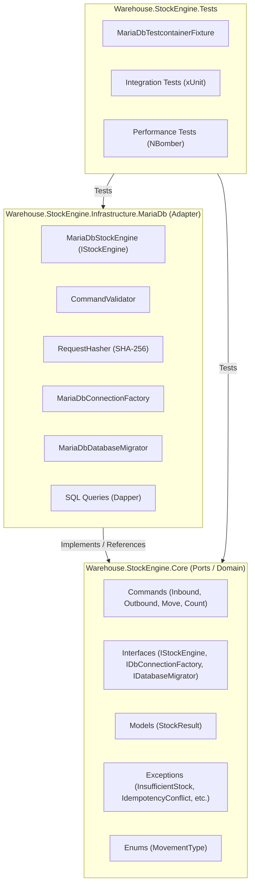
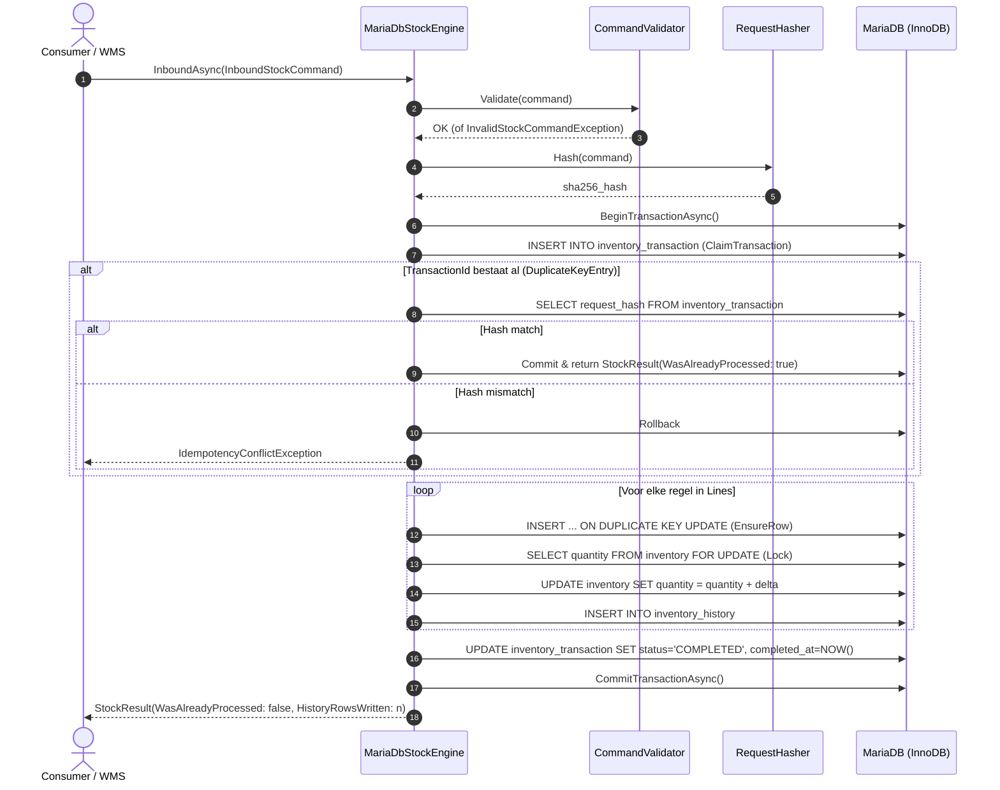

# Projectoverzicht: Warehouse.StockEngine

## 1. Executive Summary

**Warehouse.StockEngine** is een high-performance, transactionele en idempotente C# voorraadbeheer-engine (library) ontworpen voor Warehouse Management Systems (WMS). 

In plaats van een klassieke webapplicatie met HTTP controllers, is dit een **headless domain & infrastructure engine**. Het biedt strenge data-integriteitsgaranties voor voorraadmutaties via MariaDB (InnoDB), raw SQL met Dapper en MySqlConnector, met volledige auditlogging en idempotentiebewaking per transactie.

---

## 2. Architectuur & Lagen

Het project is gemodelleerd volgens de principes van **Clean Architecture** (Ports and Adapters / Hexagonal):

### Indeling van de projecten en mappen

| Project | Verantwoordelijkheid | Geen externe afhankelijkheden? |
|---|---|---|
| [`Warehouse.StockEngine.Core`](file:///home/rik/repos/StockEngine/src/Warehouse.StockEngine.Core/Warehouse.StockEngine.Core.csproj) | Definieert alle contracten, commando's, domeinmodellen en specifieke uitzonderingen. | **Ja (Zero dependencies)** |
| [`Warehouse.StockEngine.Infrastructure.MariaDb`](file:///home/rik/repos/StockEngine/src/Warehouse.StockEngine.Infrastructure.MariaDb/Warehouse.StockEngine.Infrastructure.MariaDb.csproj) | De database-specifieke executielaag, transactie-afhandeling, lockstrategie en SQL-queries. | Nee (Dapper, MySqlConnector) |
| [`Warehouse.StockEngine.Tests`](file:///home/rik/repos/StockEngine/tests/Warehouse.StockEngine.Tests/Warehouse.StockEngine.Tests.csproj) | Integratietesten tegen echte MariaDB instances via Testcontainers en NBomber load tests. | Nee (xUnit, Testcontainers, NBomber) |

### Lagen & Ontwerppatronen
- **Geen Controllers:** Het project bevat opzettelijk geen API/MVC controllers. Het is bedoeld om te worden geïmporteerd door backend-services, API gateways of background workers.
- **Service Façade i.p.v. Generic Repositories:** [`IStockEngine`](file:///home/rik/repos/StockEngine/src/Warehouse.StockEngine.Core/Interfaces/IStockEngine.cs) fungeert als de primaire service façade. In plaats van individuele repositories (`InventoryRepository`, `HistoryRepository`) worden alle mutaties per commando samengebundeld in één atomaire DB-transactie via [`MariaDbStockEngine`](file:///home/rik/repos/StockEngine/src/Warehouse.StockEngine.Infrastructure.MariaDb/Execution/MariaDbStockEngine.cs).
- **Embedded Migraties:** SQL-migraties (`001_InitialSchema.sql`) worden als embedded resource gecompileerd en beheerd door [`MariaDbDatabaseMigrator`](file:///home/rik/repos/StockEngine/src/Warehouse.StockEngine.Infrastructure.MariaDb/Database/MariaDbDatabaseMigrator.cs).

---

## 3. Tech Stack & Externe Afhankelijkheden

Het project maakt gebruik van moderne, bleeding-edge .NET technologieën:

| Categorie | Technologie / Package | Versie | Doel |
|---|---|---|---|
| **Platform** | [.NET SDK](file:///home/rik/repos/StockEngine/global.json) | **10.0.401 / 10.0.402** | Target framework `net10.0`, C# 13 |
| **Solution Formaat** | [Warehouse.StockEngine.slnx](file:///home/rik/repos/StockEngine/Warehouse.StockEngine.slnx) | Modern XML `.slnx` | Vervangt de traditionele `.sln` file |
| **Database** | MariaDB | **11.4** (InnoDB) | ACID transacties met row-level locks |
| **Data Access** | [Dapper](file:///home/rik/repos/StockEngine/src/Warehouse.StockEngine.Infrastructure.MariaDb/Warehouse.StockEngine.Infrastructure.MariaDb.csproj#L14) | `2.1.89` | Performante micro-ORM voor SQL mapping |
| **Database Driver** | [MySqlConnector](file:///home/rik/repos/StockEngine/src/Warehouse.StockEngine.Infrastructure.MariaDb/Warehouse.StockEngine.Infrastructure.MariaDb.csproj#L15) | `2.6.2` | Snelle, volledig asynchrone ADO.NET driver |
| **Unit & Integration Test**| [xUnit](file:///home/rik/repos/StockEngine/tests/Warehouse.StockEngine.Tests/Warehouse.StockEngine.Tests.csproj#L20) | `2.9.3` | Test framework |
| **Containerized Testing** | [Testcontainers.MariaDb](file:///home/rik/repos/StockEngine/tests/Warehouse.StockEngine.Tests/Warehouse.StockEngine.Tests.csproj#L19) | `4.16.0` | Start automatisch MariaDB 11.4 in Docker voor tests |
| **Load Testing** | [NBomber](file:///home/rik/repos/StockEngine/tests/Warehouse.StockEngine.Tests/Warehouse.StockEngine.Tests.csproj#L18) | `6.7.1` | Scenario load en concurrentie testing |
| **Code Coverage** | [coverlet.collector](file:///home/rik/repos/StockEngine/tests/Warehouse.StockEngine.Tests/Warehouse.StockEngine.Tests.csproj#L13) | `6.0.4` | Test coverage metrieken |

---

## 4. Core Business Logic & Datastroom

### 4.1 Locatie- en Voorraadmodel
Locaties worden 4-dimensionaal en numeriek geadresseerd:
$$\text{Locatie} = (\text{Warehouse: } \text{int}, \text{Zone: } \text{int}, \text{Bin: } \text{int}, \text{Sku: } \text{long})$$

De database bevat drie kerntabellen:
1. `inventory`: De actuele stand per `(warehouse, zone, bin, sku)`. Voorzien van check constraint `quantity >= 0`.
2. `inventory_history`: Een onveranderlijke (append-only) ledger met `history_id`, mutatie-type, before/after standen, delta en audit trails.
3. `inventory_transaction`: Idempotentie-administratie met `transaction_id` (PK, UUID), request hash (SHA-256), status, audit fields en timestamps.

### 4.2 De Vier Kernoperaties

1. **Inbound ([`InboundAsync`](file:///home/rik/repos/StockEngine/src/Warehouse.StockEngine.Infrastructure.MariaDb/Execution/MariaDbStockEngine.cs#L22)):**
   - Garandeert dat de rij bestaat via `INSERT ... ON DUPLICATE KEY UPDATE`.
   - Vergrendelt het saldo via `SELECT ... FOR UPDATE`.
   - Verhoogt het saldo en voegt een positieve historieregel toe.
2. **Outbound ([`OutboundAsync`](file:///home/rik/repos/StockEngine/src/Warehouse.StockEngine.Infrastructure.MariaDb/Execution/MariaDbStockEngine.cs#L67)):**
   - Vergrendelt het saldo via `SELECT ... FOR UPDATE`.
   - Voert een conditionele update uit: `quantity = quantity - @Quantity WHERE quantity >= @Quantity`.
   - Gooit [`InsufficientStockException`](file:///home/rik/repos/StockEngine/src/Warehouse.StockEngine.Core/Exceptions/InsufficientStockException.cs) als het saldo ontoereikend is.
   - Schrijft een negatieve delta naar de historietabel.
3. **Move ([`MoveAsync`](file:///home/rik/repos/StockEngine/src/Warehouse.StockEngine.Infrastructure.MariaDb/Execution/MariaDbStockEngine.cs#L119)):**
   - Verplaatst voorraad tussen twee bins binnen hetzelfde magazijn.
   - **Deadlock Preventie:** Sorteert de bron- en doellocaties deterministisch via [`CompareLocation`](file:///home/rik/repos/StockEngine/src/Warehouse.StockEngine.Infrastructure.MariaDb/Execution/MariaDbStockEngine.cs#L424) voordat de locks worden aangevraagd.
   - Boekt de bron af en de bestemming bij.
   - Schrijft **twee** historieregels per lijn (1 negatief op bron, 1 positief op bestemming).
4. **Count ([`CountAsync`](file:///home/rik/repos/StockEngine/src/Warehouse.StockEngine.Infrastructure.MariaDb/Execution/MariaDbStockEngine.cs#L210)):**
   - Zet de absolute voorraad (cycle count / inventarisatie) op de getelde hoeveelheid.
   - Berekent `delta = counted_quantity - before` en legt de `counted_quantity` en optionele `ReasonCode` vast in de historietabel.

### 4.3 Idempotentie-garanties
Elk commando levert een `TransactionId` (Guid) mee:
- **Nieuwe transactie:** Commando wordt geclaimd in `inventory_transaction`, mutaties worden uitgevoerd, status wordt bijgewerkt naar `COMPLETED`. Resultaat: `WasAlreadyProcessed = false`.
- **Zelfde transactie + zelfde payload hash:** Commando is reeds voltooid. Er vindt géén herhaling van voorraadmutaties plaats. Resultaat: `WasAlreadyProcessed = true`.
- **Zelfde transactie + andere payload hash:** Gooit direct [`IdempotencyConflictException`](file:///home/rik/repos/StockEngine/src/Warehouse.StockEngine.Core/Exceptions/IdempotencyConflictException.cs).

### 4.4 Sequentiële Datastroom

---

## 5. Huidige Staat & Analyse van de Codebase

### 5.1 Testresultaten & Status
- **Build Status:** Bouwt foutloos zonder waarschuwingen (`0 Warning(s), 0 Error(s)`) onder .NET 10.
- **xUnit Tests:** 65 tests slagen allemaal (50 pure unit tests + 14 integratietests + 1 load test):
  - `ConcurrencyTests`: 2 integratietests (parallelle multi-line verplaatsingen en inbounds/outbounds in omgekeerde volgorde zonder deadlocks).
  - `InventoryKeyTests`: 5 unit tests (deterministische lexicografische vergelijking op Warehouse, Zone, Bin, Sku).
  - `CommandValidatorTests`: 21 unit tests (mutatievalidatie, lege GUID, documentnummers, non-positive quantities, move to/from checks).
  - `RequestHasherTests`: 12 unit tests (determinisme, SHA-256 integriteit, line order insensitivity, decimaal invariantie, null handling).
  - `DependencyInjectionTests`: 6 unit tests (service-registraties, factory delegates, scoped/singleton lifetimes, argument validaties).
  - `MariaDbDatabaseMigratorTests`: 6 unit tests (dynamische migratiediscovery, versienaam-extractie en numerieke sortering).
  - `DatabaseMigratorTests`: 1 integratietest (idempotentie en werking van schema_migrations in MariaDB container).
  - `InboundTests`: 2 tests (succesvolle bijboeking, afwijzing negatieve/nul hoeveelheid).
  - `OutboundTests`: 2 tests (succesvolle afboeking, afwijzing ontoereikend saldo).
  - `MoveTests`: 2 tests (succesvolle verplaatsing met 2 historierijen, afwijzing ontoereikend bronsaldo).
  - `CountTests`: 3 tests (absolute telling, verhogen boven huidig saldo, audit- en reason codes).
  - `IdempotencyTests`: 2 tests (idempotent resultaat bij identieke payload, conflict exception bij gewijzigde payload).
  - `StockEngineLoadTests`: 1 geavanceerde multi-phase concurrency test met NBomber en shadow stock ledger.
- **Performance Tests:** Geavanceerde NBomber multi-phase load test met shadow ledger validatie aanwezig in [`StockEngineLoadTests.cs`](file:///home/rik/repos/StockEngine/tests/Warehouse.StockEngine.Tests/Performance/StockEngineLoadTests.cs).

### 5.2 TODO & FIXME Comments
- Er zijn **geen openstaande `TODO` of `FIXME` comments** in de broncode.
- In de [`README.md`](file:///home/rik/repos/StockEngine/README.md#L32-L34) staat wel een expliciet toekomstig verbeterpunt genoteerd:
  > *Future improvement: Optimistic concurrency on `inventory` (e.g. row version) is not implemented yet; counts currently lock with `SELECT … FOR UPDATE` only.*

---

## 6. Risico's, Verbeterpunten & To-Do Aanbevelingen

Hoewel de huidige codebase beknopt, schoon en van hoge kwaliteit is, zijn er meerdere structurele verbeterpunten en potentiële risico's geïdentificeerd:

### 1. Deterministische Lock-strategie tegen Deadlocks (Geïmplementeerd)
- ✅ In [`MariaDbStockEngine.cs`](file:///home/rik/repos/StockEngine/src/Warehouse.StockEngine.Infrastructure.MariaDb/Execution/MariaDbStockEngine.cs) worden alle betrokken unieke locaties (`InventoryKey(Warehouse, Zone, Bin, Sku)`) per commando deterministisch en globaal oplopend gesorteerd via `LockLocationsAsync` voordat enige lock (`SELECT ... FOR UPDATE`) of mutatie plaatsvindt.
- Zowel binnen afzonderlijke regels als over willekeurig geordende batches in Inbound, Outbound, Move en Count worden locks altijd in dezelfde globale lexicografische volgorde aangevraagd. Hierdoor zijn InnoDB deadlocks (foutcode 1213) wiskundig uitgesloten.
- Gedekt met unit tests voor de comparatielogica ([`InventoryKeyTests.cs`](file:///home/rik/repos/StockEngine/tests/Warehouse.StockEngine.Tests/Unit/InventoryKeyTests.cs)) en zware parallelle concurrency-integratietests met omgekeerd geordende commando's ([`ConcurrencyTests.cs`](file:///home/rik/repos/StockEngine/tests/Warehouse.StockEngine.Tests/Integration/ConcurrencyTests.cs)).

### 2. Pure Unit Tests (Geïmplementeerd)
- ✅ [`CommandValidatorTests.cs`](file:///home/rik/repos/StockEngine/tests/Warehouse.StockEngine.Tests/Unit/CommandValidatorTests.cs) (21 unit tests): dekt alle validatieregels af voor Inbound, Outbound, Move en Count, inclusief lege GUIDs, ontbrekende documentnummers, lege regellijsten, niet-positieve hoeveelheden en identieke From/To bins.
- ✅ [`RequestHasherTests.cs`](file:///home/rik/repos/StockEngine/tests/Warehouse.StockEngine.Tests/Unit/RequestHasherTests.cs) (12 unit tests): toetst determinisme, volgorde-onafhankelijkheid van regels via sortering op `DocumentLineId`, gevoeligheid voor veldwijzigingen, invariante decimaalformattering (onafhankelijk van systeemcultuur) en null-afhandeling.
- Draaien volledig in-memory zonder container- of I/O-overhead binnen ~100 milliseconden.

### 3. Onvolledige Validatie in `CommandValidator`
- `CommandValidator` controleert `Quantity > 0`, maar controleert niet op geldige numerieke identificaties zoals `Warehouse`, `Zone`, `Bin` of `Sku` (bijvoorbeeld `<= 0` of onmogelijke waarden).
- Bij `MoveStockCommand` wordt gecontroleerd of `FromZone == ToZone && FromBin == ToBin`. Echter, als `Warehouse` ongeldig is of ontbreekt, ontbreekt specifieke domeinvalidatie.

### 4. Initiële Transactie Status
- In [`StockQueries.ClaimTransaction`](file:///home/rik/repos/StockEngine/src/Warehouse.StockEngine.Infrastructure.MariaDb/Sql/StockQueries.cs#L11) wordt de transactie direct aangemaakt met `status = 'COMPLETED'`, hoewel `completed_at` nog `NULL` is en de daadwerkelijke mutaties nog moeten plaatsvinden.
- Hoewel de database-transactie atomair commit of terugrolt, is een status `'PENDING'` of `'PROCESSING'` tijdens de executiefase semantisch juister en veiliger bij latere uitbreidingen (zoals read-committed monitoring tools).

### 5. Dynamisch Migratiesysteem (Geïmplementeerd)
- ✅ [`MariaDbDatabaseMigrator.cs`](file:///home/rik/repos/StockEngine/src/Warehouse.StockEngine.Infrastructure.MariaDb/Database/MariaDbDatabaseMigrator.cs) scant nu dynamisch alle ingebedde `.sql` migratiebestanden via `DiscoverMigrations()`.
- Sortering gebeurt deterministisch via [`MigrationComparer`](file:///home/rik/repos/StockEngine/src/Warehouse.StockEngine.Infrastructure.MariaDb/Database/MariaDbDatabaseMigrator.cs#L182) op numeriek voorvoegsel (`001_`, `002_`, `10_`) en ordinaal.
- Uitgevoerde versies worden bijgehouden in `schema_migrations`; alleen nog niet uitgevoerde scripts worden stapsgewijs binnen een transactie uitgevoerd.
- Uitbreidbaar zonder code-aanpassingen: nieuwe `.sql` bestanden in `Database/Migrations/` worden automatisch meegenomen door het embedded resource wildcard-patroon in de `.csproj`.
- Getest met zowel gerichte unit tests ([`MariaDbDatabaseMigratorTests.cs`](file:///home/rik/repos/StockEngine/tests/Warehouse.StockEngine.Tests/Unit/MariaDbDatabaseMigratorTests.cs)) als integratietests ([`DatabaseMigratorTests.cs`](file:///home/rik/repos/StockEngine/tests/Warehouse.StockEngine.Tests/Integration/DatabaseMigratorTests.cs)).

### 6. Dependency Injection Support (Geïmplementeerd)
- ✅ `AddMariaDbStockEngine` en `AddStockEngine` extensiemethoden zijn toegevoegd in [`StockEngineServiceCollectionExtensions.cs`](file:///home/rik/repos/StockEngine/src/Warehouse.StockEngine.Infrastructure.MariaDb/DependencyInjection/StockEngineServiceCollectionExtensions.cs).
- Ondersteunt zowel directe connection strings als factory delegates via `IServiceProvider`, configureerbare lifetimes (standaard `Scoped`), en registreert `IDbConnectionFactory`, `IDatabaseMigrator`, `IStockEngineFactory` en `IStockEngine`.
- Volledig gedekt met 6 gerichte unit tests in [`DependencyInjectionTests.cs`](file:///home/rik/repos/StockEngine/tests/Warehouse.StockEngine.Tests/Unit/DependencyInjectionTests.cs).
